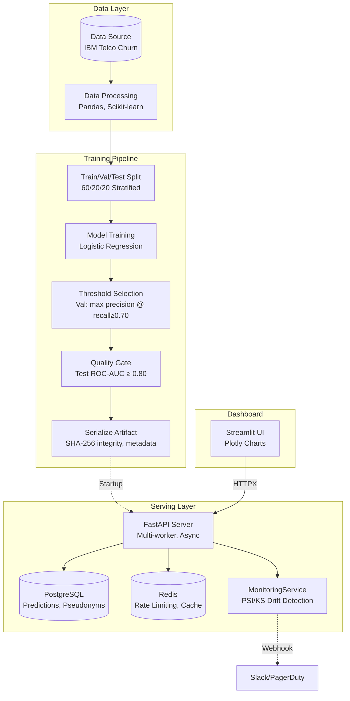

# Customer Churn Prediction & Retention Intelligence Platform

An end-to-end Machine Learning product designed to predict customer churn, identify risk segments, estimate financial exposure, and automatically generate rule-based retention actions using Explainable AI (SHAP).

## Architecture Diagram



## 1. Project Overview
This repository contains a full production-style MLOps pipeline. It ingests data, trains models without leakage, serves predictions asynchronously via FastAPI, stores records in PostgreSQL, and surfaces insights through an interactive Streamlit dashboard.

The objective is to move beyond simple Jupyter notebooks and demonstrate practical, interview-ready software engineering and data science skills.

## 2. Architecture & Tech Stack
*   **Data Processing:** Pandas, NumPy, Scikit-learn (Pipelines, ColumnTransformer).
*   **Modeling:** Logistic Regression, Random Forest, XGBoost. (Logistic Regression was chosen as the primary model due to superior ROC-AUC).
*   **Explainable AI:** SHAP (LinearExplainer).
*   **API Layer:** FastAPI, Pydantic.
*   **Frontend Dashboard:** Streamlit, Plotly, HTTPX.
*   **Database:** PostgreSQL, SQLAlchemy ORM, Alembic.
*   **Infrastructure / CI-CD:** Docker, Docker Compose, GitHub Actions.
*   **Testing:** Pytest (90% Line Coverage), Ruff (Linting).
*   **Security:** Rate Limiting (SlowAPI), Data Minimization, Configurable Retention Policy, Customer ID Pseudonymization.

See [`docs/ARCHITECTURE.md`](docs/ARCHITECTURE.md) and [`docs/AWS_DEPLOYMENT.md`](docs/AWS_DEPLOYMENT.md) for full system diagrams and cloud provisioning details.

## 3. Methodology & Results
*   **Data Strategy:** Built using the IBM Telco Customer Churn dataset (7,043 rows, Apache-2.0; provenance, license, checksum, and data-quality checks recorded in `docs/DATA_PROVENANCE.md`). We utilized strict Pydantic schemas for data ingestion validation.
*   **Evaluation:** Evaluated across a stratified 60/20/20 train/validation/test split to account for the 73/26 target imbalance. The decision threshold is selected on the validation set only (maximize precision subject to recall ≥ 0.70); the held-out test set is used once for the final gate.
*   **Production Model Metrics (shipped artifact `model_v1.joblib` v1.0.0, full IBM Telco dataset, verified run):**
    *   **ROC-AUC:** 0.8320 (quality gate ≥ 0.80: **PASSED**)
    *   **PR-AUC:** 0.6235
    *   **Recall:** 0.6604
    *   **Precision:** 0.5588
    *   **Decision threshold:** 0.6478 (selected on validation data)
    *   *Reproduce with `python -m scripts.train_and_serialize --data-path data/Telco-Customer-Churn-FULL.csv`. The full dataset is not committed to version control; fetch and verify it per `docs/DATA_PROVENANCE.md`. Historical notebook model-selection benchmarks (ROC-AUC 0.841 for Logistic Regression) are documented separately in `docs/MODEL_METRICS.md`.*
*   **Sample Dataset Metrics (100-row synthetic sample included in repo):**
    *   **ROC-AUC:** 0.3214 (fails quality gate of ≥ 0.80)
    *   **PR-AUC:** 0.2531
    *   **Recall:** 0.6667
    *   **Precision:** 0.2857
    *   *The 100-row sample is insufficient for model quality and is provided only for pipeline testing. Its metrics are never production metrics, and artifacts trained on it are rejected by production validation (unknown data provenance).*
*   **Threshold Tuning:** The active decision threshold in `model_v1.joblib` (**0.6478**) was selected by the automated validation rule described above (≈ the previously hand-tuned 0.65), decreasing false-positive churn flags to optimize marketing spend ROI.
*   **Quality Gate:** Training pipeline enforces ROC-AUC ≥ 0.80 on held-out test set and refuses to serialize a model that fails it. The gate passes with the full dataset and fails with the 100-row sample.
*   **Production Artifact Enforcement:** In production mode the API validates model version, feature schema, threshold metadata, drift reference data, and data provenance at startup; `*-test` artifacts or artifacts without a checksum-resolvable dataset origin fail startup clearly — there is no silent fallback to random predictions.

## 4. Business Rules & Retention Logic
The platform translates probabilities into actionable intelligence:
*   **Risk Segmentation:** `<30%` (Low), `30-64%` (Medium), `>=65%` (High).
*   **Revenue Exposure:** `Probability * MonthlyCharges * 12 months`.
*   **Rule Engine:** If a customer is high risk *and* SHAP indicates their high Monthly Bill is driving their churn probability, the system automatically recommends an "Offer $10 Monthly Loyalty Credit" intervention. See [`docs/BUSINESS_RULES.md`](docs/BUSINESS_RULES.md) for the full mapping table.

## 5. Security & Data Protection
The platform implements several security and data protection measures:

### Rate Limiting
*   **Endpoint-specific Limits:** Configurable rate limits per endpoint (e.g., 60/min for `/predict`, 10/min for `/predict/batch`).
*   **Client Identification:** Uses API key for authenticated clients, falls back to IP address. API key is hashed (SHA-256) in rate limit keys to avoid leaking partial keys in logs.
*   **Standard Headers:** Returns `X-RateLimit-Limit`, `X-RateLimit-Remaining`, `X-RateLimit-Reset` headers.

### Data Minimization
*   **Configurable Minimization:** Only non-sensitive fields persisted in `raw_features` (enabled by default via `DATA_MINIMIZATION_ENABLED`).
*   **Sensitive Fields Excluded:** Direct identifiers (customerID), financial data (MonthlyCharges, TotalCharges), demographic data (gender, SeniorCitizen), and billing info (PaymentMethod, Contract) are excluded from `raw_features` when minimization is enabled.
*   **Business Fields Retained:** Fields required for retention logic (Contract, MonthlyCharges, InternetService, TechSupport) and monitoring (tenure) are retained.
*   **Metadata Tracking:** Minimization metadata stored with each record (`_minimized`, `_minimized_at`, field counts).

### Customer ID Pseudonymization
*   **Salted SHA-256 Hashing:** Customer IDs are pseudonymized using a salted SHA-256 hash before storage in `customer_id_hash` column.
*   **Authorized Lookup Table:** `customer_pseudonym_lookup` table maps hashes to original IDs for authorized personnel only.
*   **Access Auditing:** All de-pseudonymization requests are logged with access count and timestamp.
*   **Production Salt Required:** `PSEUDONYMIZATION_SALT` must be configured (min 16 chars) in production.

### Data Retention Policy
*   **Configurable Retention Period:** Default 90 days (configurable via `DATA_RETENTION_DAYS`).
*   **Automated Cleanup:** `scripts/cleanup_retention.py` deletes expired records in bounded batches.
*   **Safe Cleanup:** Dry-run mode (`DATA_RETENTION_DRY_RUN`) for verification before deletion.
*   **Statistics Reporting:** `get_retention_stats()` provides counts of expired vs active records.
*   **Cascade Deletion:** Associated retention recommendations deleted with prediction records.

### Audit & Monitoring
*   **Structured Logging:** JSON-formatted request metrics with no sensitive data.
*   **Drift Detection:** Population-level drift detection via `MonitoringService` (PSI/KS test).
*   **Request ID Propagation:** `X-Request-ID` header flows through logs, metrics, and database for distributed tracing.
*   **Model Version Header:** `X-Model-Version` header on all responses for client-side version tracking.
*   **No Secrets in Logs:** Logging configuration excludes sensitive fields.

## 6. API Examples

### Single Prediction
```bash
curl -X POST http://localhost:8000/predict \
  -H "Content-Type: application/json" \
  -H "X-API-Key: your-api-key" \
  -d '{
    "customerID": "1234-ABCD",
    "gender": "Female",
    "SeniorCitizen": 0,
    "Partner": "Yes",
    "Dependents": "No",
    "tenure": 12,
    "PhoneService": "Yes",
    "MultipleLines": "No",
    "InternetService": "DSL",
    "OnlineSecurity": "No",
    "OnlineBackup": "Yes",
    "DeviceProtection": "No",
    "TechSupport": "Yes",
    "StreamingTV": "No",
    "StreamingMovies": "No",
    "Contract": "Month-to-month",
    "PaperlessBilling": "Yes",
    "PaymentMethod": "Electronic check",
    "MonthlyCharges": 50.0,
    "TotalCharges": "600.0"
  }'
```

**Response:**
```json
{
  "customerID": "1234-ABCD",
  "churn_probability": 0.73,
  "churn_prediction": 1,
  "risk_segment": "High Risk",
  "model_version": "1.0.0"
}
```

**Headers:** `X-Model-Version: 1.0.0`, `X-Request-ID: <uuid>`

### Batch Prediction
```bash
curl -X POST http://localhost:8000/predict/batch \
  -H "Content-Type: application/json" \
  -H "X-API-Key: your-api-key" \
  -d '{
    "customers": [
      {"customerID": "1111-TEST", "gender": "Male", "SeniorCitizen": 0, "Partner": "No", "Dependents": "No", "tenure": 5, "PhoneService": "Yes", "MultipleLines": "No", "InternetService": "Fiber optic", "OnlineSecurity": "No", "OnlineBackup": "No", "DeviceProtection": "No", "TechSupport": "No", "StreamingTV": "Yes", "StreamingMovies": "Yes", "Contract": "Month-to-month", "PaperlessBilling": "Yes", "PaymentMethod": "Electronic check", "MonthlyCharges": 85.0, "TotalCharges": "425.0"},
      {"customerID": "2222-TEST", "gender": "Female", "SeniorCitizen": 1, "Partner": "Yes", "Dependents": "Yes", "tenure": 36, "PhoneService": "Yes", "MultipleLines": "Yes", "InternetService": "DSL", "OnlineSecurity": "Yes", "OnlineBackup": "Yes", "DeviceProtection": "Yes", "TechSupport": "Yes", "StreamingTV": "No", "StreamingMovies": "No", "Contract": "Two year", "PaperlessBilling": "No", "PaymentMethod": "Bank transfer (automatic)", "MonthlyCharges": 45.0, "TotalCharges": "1620.0"}
    ]
  }'
```

### SHAP Explanation
```bash
curl -X POST http://localhost:8000/explain \
  -H "Content-Type: application/json" \
  -H "X-API-Key: your-api-key" \
  -d '{"customerID": "1234-ABCD", "gender": "Female", "SeniorCitizen": 0, "Partner": "Yes", "Dependents": "No", "tenure": 12, "PhoneService": "Yes", "MultipleLines": "No", "InternetService": "DSL", "OnlineSecurity": "No", "OnlineBackup": "Yes", "DeviceProtection": "No", "TechSupport": "Yes", "StreamingTV": "No", "StreamingMovies": "No", "Contract": "Month-to-month", "PaperlessBilling": "Yes", "PaymentMethod": "Electronic check", "MonthlyCharges": 50.0, "TotalCharges": "600.0"}'
```

**Response:**
```json
{
  "customerID": "1234-ABCD",
  "base_value": -0.123,
  "features": [
    {"name": "MonthlyCharges", "contribution": 0.15},
    {"name": "Contract_Month-to-month", "contribution": 0.08},
    {"name": "tenure", "contribution": -0.05}
  ]
}
```

### Retention Recommendation
```bash
curl -X POST http://localhost:8000/retention-recommendation \
  -H "Content-Type: application/json" \
  -H "X-API-Key: your-api-key" \
  -d '{"customerID": "1234-ABCD", "gender": "Female", "SeniorCitizen": 0, "Partner": "Yes", "Dependents": "No", "tenure": 12, "PhoneService": "Yes", "MultipleLines": "No", "InternetService": "DSL", "OnlineSecurity": "No", "OnlineBackup": "Yes", "DeviceProtection": "No", "TechSupport": "Yes", "StreamingTV": "No", "StreamingMovies": "No", "Contract": "Month-to-month", "PaperlessBilling": "Yes", "PaymentMethod": "Electronic check", "MonthlyCharges": 50.0, "TotalCharges": "600.0"}'
```

**Response:**
```json
{
  "customerID": "1234-ABCD",
  "risk_segment": "High Risk",
  "annual_revenue_exposure": 438.0,
  "recommendations": [
    {"action": "Offer Annual Upgrade Discount", "reason": "Customer is on Month-to-month contract..."},
    {"action": "Offer $10 Monthly Loyalty Credit", "reason": "High monthly charges are a primary driver..."}
  ]
}
```

### Model Versioning
```bash
# List all available model versions
curl -X GET http://localhost:8000/model/versions -H "X-API-Key: your-api-key"

# Get current production model
curl -X GET http://localhost:8000/model/current -H "X-API-Key: your-api-key"
```

### Health & Metrics
```bash
# Health check (no auth)
curl http://localhost:8000/health

# Readiness check (no auth)
curl http://localhost:8000/ready

# Prometheus metrics (no auth)
curl http://localhost:8000/metrics
```

## 7. Quick Start (Local Setup)
Ensure you have Docker and Docker Compose installed.

```bash
# 1. Clone the repository
git clone <url>
cd churn_platform

# 2. Configure environment (copy example and edit)
cp .env.example .env
# Edit .env with your values

# 3. Build and run the containers (API, Dashboard, PostgreSQL)
docker compose up --build

# 4. Access the interfaces
# Streamlit Dashboard: http://localhost:8501
# FastAPI Swagger Docs: http://localhost:8000/docs
```

### Local Development without Docker
```bash
# Install dependencies
pip install -e .[dev]

# Generate test model artifact
python -m scripts.create_test_artifact

# Run API server (requires .env with DATABASE_URL or uses SQLite fallback)
uvicorn src.api:app --reload

# Run dashboard
streamlit run dashboard/app.py
```

## 7. Testing Coverage
The platform maintains **90% Line Coverage** across the `src/` directory (minimum 90% enforced in CI) with **129 tests**.
Run the suite locally using:
```bash
pip install -e .[dev]
pytest --cov=src --cov-fail-under=90
ruff check .
mypy src/
```

### Data Protection Tests
```bash
# Run data protection and retention tests specifically
pytest tests/test_data_protection.py -v
```

## 8. Data Retention Cleanup
Run the retention cleanup job manually or schedule via cron/Kubernetes CronJob:
```bash
# Dry run (logs what would be deleted)
python scripts/cleanup_retention.py --dry-run

# Actual cleanup
python scripts/cleanup_retention.py

# Show retention statistics only
python scripts/cleanup_retention.py --stats-only

# Override retention period
python scripts/cleanup_retention.py --retention-days 180
```

## 9. Continuous Integration
The project uses GitHub Actions for CI. The workflow runs on every push and pull request to `main` and `develop` branches.

### CI Pipeline Stages
1. **Lint & Type Check** - Runs `ruff check .` and `mypy src/`
2. **Tests with Coverage** - Runs pytest with `--cov=src --cov-fail-under=90`
3. **Security Scan** - Runs `pip-audit` for dependency vulnerabilities
4. **CloudFormation Lint** - Validates AWS CloudFormation template
5. **PostgreSQL Integration Tests** - Runs against real PostgreSQL
6. **Docker Build (API)** - Builds `Dockerfile.api`
7. **Docker Build (Dashboard)** - Builds `Dockerfile.dashboard`
8. **Load Test (Locust)** - Runs load test against API container

### Running CI Locally
```bash
# Install dev dependencies
pip install -e .[dev]

# Generate test model artifact (required for API tests)
python -m scripts.create_test_artifact

# Run all CI checks
ruff check .
mypy src/
pytest --cov=src --cov-fail-under=90
```

### GitHub Actions Workflow
The workflow is defined in `.github/workflows/ci.yml` and includes:
- Parallel execution of lint/type-check, tests, and Docker builds
- Coverage reporting with 90% minimum threshold
- Docker layer caching via GitHub Actions cache
- Proper failure handling - any failed check fails the entire workflow

## 10. Limitations & Caveats
*   **Dataset Limitations:** The IBM Telco dataset lacks continuous behavioral data (e.g., login frequency, customer support tickets over time). Our retention recommendations are limited to static demographic/contract triggers.
*   **Model Persistence:** Currently, the artifact is built via script and committed to the file structure locally. In a full cloud production environment, the FastAPI app should pull the latest `joblib` artifact directly from AWS S3 upon startup to reduce container image bloat.
*   **Rate Limiting Backend:** Current implementation uses in-memory rate limiting (SlowAPI default). For multi-worker or distributed deployments, configure a shared backend (Redis) via SlowAPI's `RedisStorage`.
*   **Compliance Note:** The implemented technical controls (encryption at rest via PostgreSQL, deletion, minimization) support data protection requirements but do not constitute legal GDPR/CCPA compliance. Legal review required for production deployments handling real customer data.
*   **Data Minimization Trade-off:** Minimization reduces stored data but may limit future analysis. The `raw_features` column can be re-enabled via `DATA_MINIMIZATION_ENABLED=false` if full record retention is required.